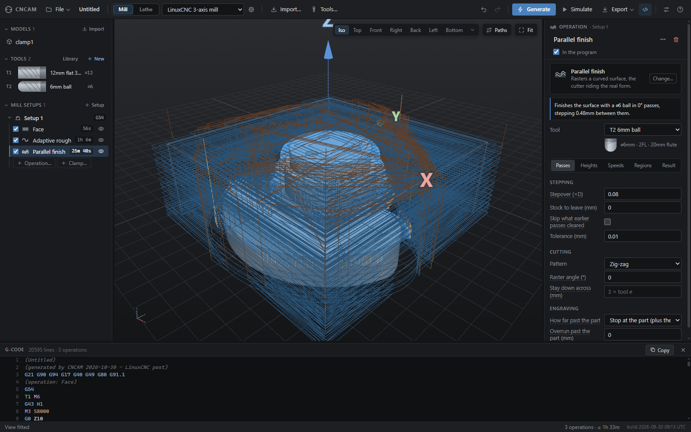
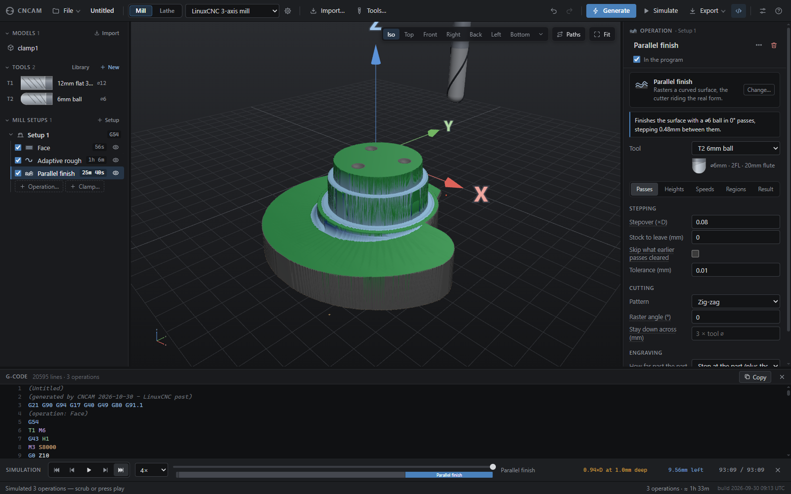
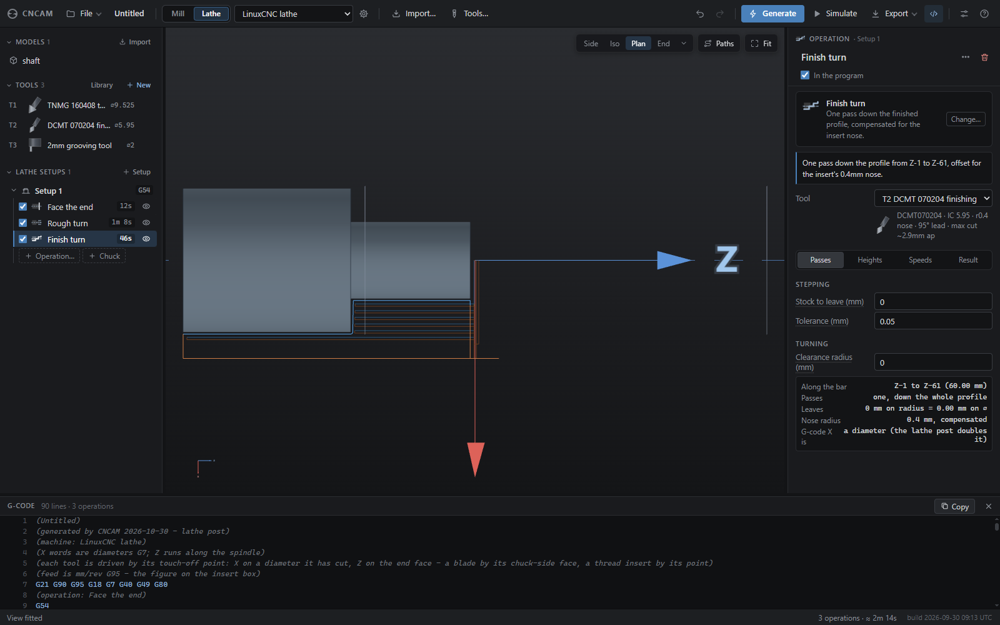
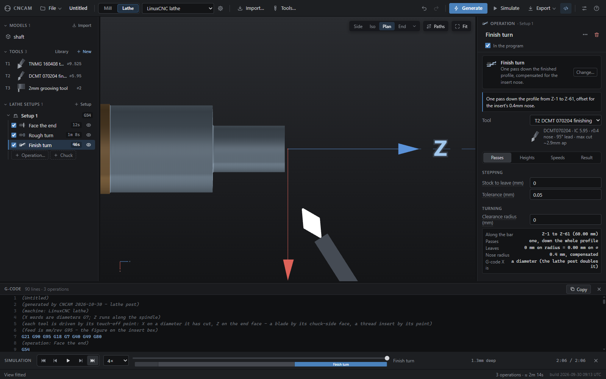

# CNCAM

A CAM program that runs in your browser. You load a 3D model, tell it what tools
you have and what cuts you want, and it writes G-code.

### ▶ Try it now: **[gamerpaddy.github.io/CNCAM](https://gamerpaddy.github.io/CNCAM/)**

No install, no sign up, nothing sent anywhere. That link is the current `main`
branch running in your own browser, and it is the whole application rather than
a cut down demo. Load a model from [samples/](samples/), or one of your own.
The test suite runs there too, at
[/test.html](https://gamerpaddy.github.io/CNCAM/test.html).

**Read the warning below before you point any of the output at a machine.**

---

# ⚠️ THIS IS AN EXPERIMENT. IT IS NOT FINISHED.

## **DO NOT RUN THE OUTPUT OF THIS PROGRAM ON A REAL MACHINE WITHOUT CHECKING EVERY LINE OF IT FIRST.**

**This is a hobby project and a work in progress. It has never been validated
against a real machine tool by anyone. It may not work at all. It may look like
it works and be wrong in ways you will not notice until the spindle is already
moving.**

**G-code from an untested CAM program is dangerous. It can drive the tool into
your fixture, your vise, your table or your workholding. It can break cutters,
throw parts, wreck a spindle and injure you. The simulation in this app is a
drawing, not a promise: if it is wrong about the geometry then it is wrong in
the picture too, and it will happily show you a clean cut that is not one.**

**Before anything touches metal: read the file, backplot it in your controller,
dry run it above the work with the Z offset raised, and keep a hand on the feed
hold. If you do not know how to do those things, this program is not for you
yet.**

**There is no warranty of any kind. If you use this and it destroys your
machine, ruins your part, sets fire to your workshop or burns down your house,
that is on you.**

You have been warned. With that out of the way:

---

## Contents

* [A look at it](#a-look-at-it)
* [What it does](#what-it-does)
  * [Getting a part in](#getting-a-part-in)
  * [Milling operations](#milling-operations)
  * [Turning operations](#turning-operations)
  * [Tools](#tools)
  * [Machines](#machines)
  * [Everything else](#everything-else)
* [What it does not do](#what-it-does-not-do)
* [Running it locally](#running-it-locally)
  * [Tests](#tests)
* [Licence](#licence)
* [More detail](#more-detail)

## A look at it

A milling job on a sample part: face, adaptive rough with a 12mm flat, parallel
finish with a 6mm ball. Left, the toolpaths over the model; right, the same
program run through the simulation and measured against the part (green is the
part, blue is metal still standing on it).

| Toolpaths | Simulation checked against the model |
|---|---|
|  |  |

And a lathe job: face the end, rough turn, finish turn with a nose-compensated
insert, drawn with the insert and holder, and the bar as it comes out.

| Toolpaths | Simulation |
|---|---|
|  |  |

## What it does

CNCAM covers the middle of the CAM workflow: model in, program out. It does not
model parts and it does not talk to machines.

**Milling and turning are separate machines in the app**, not two spellings of
the same program. A lathe has its own operations, its own coordinates and a part
that is a profile rather than a solid, so switching machine switches the whole
app with it. One project can hold both, because a shaft that gets turned and
then has a flat milled on it is one part and two jobs.

### Getting a part in

STEP and IGES (through a WebAssembly build of OpenCASCADE, with the B-rep faces
kept separate so you can pick a real face instead of a triangle), plus STL and
OBJ.

DXF comes in as a *drawing* rather than a solid: polylines with their bulge arcs,
circles, arcs, ellipses and B-splines, which you then place on the billet and
engrave. That is how you cut a logo, a part number or a fold line, none of which
are features of the part.

Any of these can be dragged onto the window instead of opened from the toolbar —
and so can a `.cncam` project, or a G-code file to check.

### Milling operations

| Group | Operations |
|---|---|
| Prepare the stock | Face |
| Roughing | Adaptive rough, Z-level rough |
| Profiles | Contour, Pocket, Slot |
| Holes | Spot drill, Drill, Tap, Thread mill, Helical bore |
| Edges and marking | Chamfer, Engrave, V-carve (with inlay) |
| 3D finishing | Parallel finish, Waterline finish, Constant-scallop finish, Pencil finish |

Roughing is stock aware and can rest machine against what an earlier operation
already took off, so the finisher is not cutting air for an hour.

A hole is finished, not just made: spot the centres so the drill starts where it
was told, drill them, and then either **tap** them — rigid tapping, spindle
locked to the feed, and it looks for the *tapping drill* because an M6 goes in a
⌀5 hole — or **thread mill** them, which needs no rigid tapping and no tapping
head, does every diameter of one pitch with one cutter, and comes back out of
the hole when it breaks. The spot depth is not typed: it is a cone of the
cutter's own point angle, sunk until it is as wide as you asked.

**V-carve** fills a drawn shape with a groove whose depth follows its width, cut
with a V bit: the opening at the surface is the outline, and the groove is as
deep as the V reaches from the wall, down to a limit, stopping on its own where
the shape is too narrow to go deeper. It also makes an **inlay**: a recess, and
the plug that fits it, pulled in by the glue gap all round. It follows a DXF
drawing — there is no font in the program, so lettering has to arrive as outlines.

**Constant-scallop finishing** spaces its passes by distance *along the surface*
rather than across the plan, so the ridge between them is the height you asked
for on a steep wall as well as on a floor (a raster at the same plan step is 41%
too wide on a 45° face). **Pencil finishing** finds the creases a larger cutter
left — inside corners, valleys narrower than its ball — from the size of the
cutter that left them, and runs a small one down them. Both see the part from
above only, like the other heightmap finishers.

### Turning operations

Face the end, rough turn, finish turn, groove, thread, centre drill, bore, and
part off. Turning tools are described the way ISO describes them, by shape
letter, inscribed circle and nose radius, so typing `TNMG160408` fills in the
geometry and the app draws the actual insert rather than a generic cone.

### Tools

A library of cutters organised by family (flat, ball, bull nose, drill, spot
drill, tap, thread mill, chamfer and V bit, face mill, turning insert, boring
bar, parting and grooving blade, threading tool), each with starting feeds and speeds. New tools come from a
wizard that asks only the questions that apply to the shape you picked. Every
cutter is drawn to scale from its own numbers. Your own tools are saved in the
browser, and the whole library imports and exports as JSON.

### Machines

A machine is a record you can edit, not just a G-code flavour: travel limits,
rapid rates, spindle range and tool change time. Those numbers do work. The
cycle time estimate uses the machine's real rapid rate and its real tool change
time, and a program that will not fit in the envelope, or that asks for more rpm
than the spindle has, tells you in the setup panel instead of as an alarm
halfway through the job.

A milling machine can also carry **rotary axes**, and they do two different
jobs. Set a setup to **Wrapped** and give it a bar diameter, and the program you
write flat — against the cylinder's surface unrolled, a sheet π×⌀ wide — is bent
round the rotary axis on the way out: Y millimetres along the sheet become A
degrees round the bar. That is how a spline, a scale round a dial or a name down
a tube gets cut, none of which lie flat at any angle. It posts as lines with
inverse-time feed, because F is millimetres a minute on a linear move and
degrees a minute on a rotary one and no control can tell which a block meant.

Or, for indexed 3+1 / 3+2 work, pick a configuration under *Machines → Rotary
axes* (a 4-axis A, or a 5-axis A/C or B/C trunnion), set a setup to **Indexed**
and rotate it to the face you want: the machine swings the rotary axes to that
orientation, locks, and cuts it three-axis, without you re-fixturing. LinuxCNC
drives that with a G68.2 tilted work plane; the setup panel tells you whether
the machine can reach the face.

**Simultaneous 5-axis is a beta**, off until you switch it on under
*Options → Experimental*. One strategy so far — **5-axis finish**, a raster over a
surface with the cutter leaning to it (a lead and a tilt from the surface normal,
a limit on how far from vertical, a limit on how fast the lean may change, a
tolerance on how far the lean may stray from the normal so the turntable turns as
little as the surface allows, lifting out before the turntable runs into its stop,
and backed off toward upright wherever the holder would be in the part) — on a
table-table trunnion (A/C or B/C). The post writes the tool tip and the two
rotary words under tool-centre-point (`G43.4`, or LinuxCNC's trt kinematics), or
writes machine axes itself with an inverse-time feed for a control that has no
TCP; the simulation sweeps the leaning cutter, finds the holder or the shank in
the metal or a clamp, and reports how far out on the cutter the work is done (a
ball nose cutting on its tip is cutting at no speed); and the setup panel has a
checklist — machine, rotary centre, which way A and C turn, undercuts, the
holder, the clamps — with a fix button where there is one. The simulation can
draw a leaning cut three ways — the cutter tilting over a still part (head-head),
the part tilting under an upright cutter (table-table), or the cutter leaning
while the part turns (head-table) — chosen in Options or from the simulation bar;
it is the same cut and the same program, drawn the way your machine moves.
**The limits are real:**
the simulation sees the part from above only, so an undercut is not machined and
not shown; the post has not met your machine, and a mirrored A or C does not
alarm, it cuts the mirror image; and nothing here has been run on a real control.
Dry-run every program in the air.

Posts included: LinuxCNC, GRBL, and a lathe post.

### Everything else

* **Propose operations from the part.** Reads the model — the top, the enclosed
  pockets, every round hole by size, the billet round the outline — and offers
  the operations for them, in running order, as a checklist, with the cutters
  (from your rack where it has them, new ones with speeds for your material
  where it has not). A hole the size of a tapping drill offers the tap, switched
  off: a 5 mm hole is as likely to be a 5 mm hole as an M6. Nothing is added
  until you say, and what you tick goes in as one undo step.
* **Material.** A setup says what its billet is made of. It sets the speeds and
  feeds the tool wizard suggests (with chip thinning for a light cut), what each
  cut is checked against — surface speed, chip load, and the power it takes
  against the machine's spindle — and how the stock looks in the simulation.
* **Feed from the cut.** One feed for a whole path is slow where the cutter is
  barely touching and fast where it is buried. *Set feed from the cut* (on an
  operation's Speeds tab) runs the simulation, measures how wide and how deep
  each move cut, and varies the feed to suit — the chip stays as thick as it
  should be where the cut is light, the removal rate stays where it was meant to
  be where it is heavy, the machine's fastest feed and its spindle power are
  ceilings, and it slows *before* a heavy bite. Not one coordinate moves. It is
  measured against the app's own simulation, not a machine: dry-run it.
* **Optimise the running order.** Fewer tool changes and less travel, without
  moving anything that depends on what came before: operations that cut the
  same ground, passes that read earlier ones (rest machining, the finishers),
  the spot–drill–tap chain, commands and the cut that frees the part keep their
  order. It shows what it saves and applies as one undo step.
* **Copies of the part.** A grid or a circle of the same part on one billet, one
  work offset, one program: every operation is generated over all the copies, so
  one tool change serves every part. A face picked on the original is picked on
  every copy. (One work offset for the whole array.)
* **Probing blocks.** The Command operation can write a touch-off block — Z, an
  edge, a corner, a bore centre — for you to read and run from the machine's own
  screen. This program writes the text and nothing else.
* **A setup sheet** for the bench: the tools with their stick-out, every
  operation's real spindle speed and feed (an operation's own over its tool's),
  time, tool changes, and the result of the check on the finished part, to print
  or save as a page.

* Setups with their own orientation and work offset, so you can flip the part
  and machine the other side as a second setup — and the second setup starts
  from what the first one left, hole for hole, rather than from a fresh block.
* Stock as a box, a cylinder or a tube, sized outright or as a margin around
  the model, with fixtures and clamps as keep-out volumes the toolpaths avoid.
* A vice, chuck or fixture plate imported from an STL, OBJ, STEP or IGES file
  (Clamp… → from a model file). Operations keep out of what stands beside the
  work, and every generated toolpath is checked against the whole model with
  the cutter, shank and holder — a hit is flagged on the operation, in the
  simulation and before export. The model is read as its top surface on a
  0.5mm grid, so it finds a tool that is in the fixture, not one that grazes it.
* Material removal simulation you can scrub through, which shows the cut shape
  and reports the load.
* When an operation fails or warns, the message comes with where to change it —
  each field it is about as a button that opens its tab and marks it — and,
  where a safe change answers it, that change as one press (lean less, sample
  more coarsely, lift clearance over the clamp), which then generates again.
  The snap-to buttons under the heights are greyed out with the reason when the
  other heights do not allow them, instead of failing on the status line.
* **A check on the finished part.** The surface the program leaves is measured
  against the model it was made from, and the stock is coloured by the
  difference: green is the part, blue is metal still standing on it, red is
  metal cut out of it. The worst of each is named with the operation that did
  it, and clicking takes you to that move. It is the one question nothing else
  here answers — every other check compares a stage with the stage before it.
* Holding tabs, lead in and lead out, ramped and helical entry, arc fitting on
  the way out to G2/G3.
* **Reading a program back in.** *Export → Check a G-code file* opens any `.nc` —
  ours, another CAM system's, or one somebody typed — draws it, simulates it
  against the billet, measures what it leaves against the model, and checks it
  for travels, clamps, rapids that take metal, a holder in the wall, a tap with
  no hole under it and a thread cut in bar that was to be bored or turned away
  first. Inch programs, incremental
  programs, R-format arcs and canned cycles all come in; anything it cannot read
  it names rather than skipping.
* And it checks its own posts the same way. Every time a program is written the
  file is read straight back and compared with the path it was printed from, so
  a flipped G2/G3 or a lost modal word is a warning rather than a scrapped part.
* **Bad input is told, not thrown.** A truncated or garbage STL, a DXF with a
  circle at 1e300, an OBJ with indices that point nowhere, a project file with a
  missing field, a number typed as `1e999` or a tool library with a hole in it
  are each named in the status line rather than breaking the page. A project
  that has to be repaired on the way in says what it dropped and what it reset.
  Settings are held to the range their field allows, and an operation told to do
  something it cannot (a cutter wider than the part, a stock a hundred metres
  long, a peck of a billionth of a millimetre) says so and does a bounded
  version of it instead of hanging. A long **Generate** has a **Stop** button
  that cancels what the workers are still computing.
* **Holes are visited in a short route.** Drill, spot, tap, thread mill and bore
  walk their holes by nearest neighbour with a 2-opt pass on top, starting where
  the old raster started, so a plate of scattered holes no longer sends the head
  back and forth across it.
* Projects save to a file, and the browser keeps a drawer of them for you —
  **File → Projects in this browser** — where every save is a new version, nothing is overwritten, and
  any version can be opened or downloaded as a .cncam file. The session autosaves
  there too, geometry included, so a reload does not cost you an afternoon of setup.
* Tools can carry a photograph of the actual cutter, taken with the webcam or
  dropped in from a file. Two 6mm 3-flute end mills are one drawing and two very
  different tools; the picture is what tells them apart. It is kept with the tool,
  so it travels into the catalogue, an exported library and the project.
* Export the whole program or one operation at a time.
* **Generate recomputes only what changed.** Every operation remembers what it
  was generated from, and one whose settings, tool, stock and model are all as
  they were keeps its toolpath — so changing one stepover in a ten-operation job
  waits for that one operation, not the whole job. Paths are drawn as each one
  finishes. Shift+click on Generate recomputes everything.
* Each machine carries its own **start and end G-code** — the work offset it homes
  into, an air blast, the `G53 G0 Z0` that parks the head where the vice is
  reachable — and what to write **before every tool change**. Written verbatim,
  after the safety header and before the end of program, and never followed to
  another machine.
* A **Command** operation is nothing but G-code you type, placed in the running
  order between the cuts: a tool change that is not a T word, a pause to move a
  clamp, a probe macro. Blocks can be saved as presets — for one machine or for
  all of them — and the presets are kept in the browser, so they outlive the job
  they were first typed for.

## What it does not do

Be clear about this before you start: **the output is 3-axis milling — with
indexed 3+1 / 3+2 positioning — and 2-axis turning.** What goes past that is
either narrower than its name or not built:

* Simultaneous 5-axis is a **beta** (Options → Experimental) and is narrower
  than the name: one finishing strategy, table-table trunnions only, a part seen
  from above only, no arcs or canned cycles in the leaning operations, and not
  combinable with an indexed or wrapped setup. Everything else — indexed 3+1 /
  3+2 included — is still three-axis in a tilted frame (a G68.2 tilted work
  plane on LinuxCNC).
* No probing, no tool length measurement cycles, no canned cycle library beyond
  what the strategies emit themselves.
* No cloud, no account, no telemetry. Nothing leaves your browser.

**And no sender — not now and not later.** This program writes a file. It does
not open a serial port, it does not talk to a controller, it does not jog an
axis, and it never will. That is a design rule rather than a missing feature,
and it is the reason the warning at the top of this page is survivable: nothing
here can move your machine, so every mistake it makes is a mistake you get to
find by reading the file, backplotting it and dry-running it. A CAM program that
could press cycle start would put its own bugs one click away from your
spindle. Getting the file to the machine is your problem, and keeping it that
way is the point.

## Running it locally

You need a **modern browser** and a **way to serve a folder over HTTP**. It will
not run from a `file://` URL, because the WebAssembly importer and the background
workers refuse to load that way. Everything else is included in the download,
including the libraries, so there is nothing to install and nothing to build.

Chrome or Edge give you the best version of this, because they support the File
System Access API and you get real open and save dialogs. Firefox and Safari
work, but saving falls back to the downloads folder.

Download it:

```bash
git clone https://github.com/gamerpaddy/CNCAM.git
```

Then start a server in that folder. If you have Python:

```bash
python serve.py 8500
```

That one is worth preferring during development because it disables caching, so
edited files actually reload. Any static server does the job though:

```bash
npx serve
```

Open the address the server prints, for example `http://localhost:8500`. That is
the whole install.

The build stamp in the bottom-right corner tells you which build you are looking
at. On the deployed site a service worker (`sw.js`) fetches every module fresh
from the network, so a push shows up on the next reload without a Ctrl-F5. If you
develop against this repo, enable the hook that stamps the build on each commit:

```bash
git config core.hooksPath .githooks
```

> If the page does not load and the port looks fine, check that the port is not
> reserved by your OS. On Windows, Hyper-V takes large ranges of them, and a
> server that appears to start can be unreachable. `netsh interface ipv4 show
> excludedportrange protocol=tcp` lists them.

### Tests

There are well over a thousand of them, among them a robustness suite that feeds the
importers, the project loader, the G-code reader and every strategy input they
were never meant to receive.

```bash
node src/test/node-run.js
```

The ones that need a browser live at `/test.html` on the running server.

And one more pass that neither of those can make: the app itself, driven through
its own buttons, menus, tree rows, panel fields, dialogs and keys, about three
hundred checks in half a minute. Open the app on the running server and, in the
browser console:

```js
const report = await (await import('/src/test/app-sweep.js')).sweep();
```

It works on the job in front of you and puts it back afterwards — the project,
the session file and every preference. `sweep({ only: ['tree', 'keys'] })` runs
some of it.

## Licence

CNCAM is released under the [WTFPL](LICENSE). Do whatever you want with it. But dont blame me if something goes wrong.

The vendored libraries are a separate matter. Those are other people's work and keep
their own licences, so those apply if you redistribute them. three.js is MIT and
Clipper is BSL-1.0, which ask for little beyond leaving the notices alone. The
OpenCASCADE build behind STEP and IGES import is LGPL-2.1, which asks that people
be able to replace it. They can: it loads at runtime from `vendor/occt/` over a
relative path, so swapping those two files needs no rebuild of anything else.

## More detail

* [docs/internals.md](docs/internals.md) covers how it works inside, and why
  various parts are built the way they are instead of the obvious way.
* [PLAN.md](PLAN.md) is the original development plan.

## Before / after improvements

See [the improvement report](docs/IMPROVEMENTS.md) for the fixes, the new workflow tools and how they were validated.
